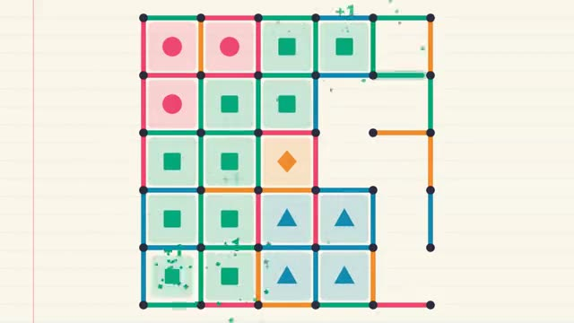

# Dots and Boxes

Draw a line. Close a box. Go again. A multiplayer starter game from [Multiplayer Agent](https://multiplayeragent.com): 2D, turn-based, 2–4 players plus anyone who wants to watch, with bots that fill empty seats.

## How it plays

Take turns drawing a line between two dots. Close a box to claim it and draw again; when every line is in, most boxes wins. Up to 4 play at once, bots fill the empty seats, and anyone else watches and joins the next game.

**Controls:** Click or tap between two dots (on a phone, slide to the line and let go).

## Make it yours in the Game Builder

Open the [Game Builder](https://multiplayeragent.com), choose **Start from a starter game** and pick Dots and Boxes. It opens as version 1 in your studio, ready to play and publish. Then ask for changes, for example:

- Make the grid 7 by 7
- Add golden boxes worth 3 points
- Make it a chalkboard with chalk sounds

## Run it yourself

1. Get a free publishable key (`pk_…`) at [multiplayeragent.com](https://multiplayeragent.com).
2. In `index.html`, put it in place of `pk_REPLACE_ME` in the `MP_CONNECT` block.
3. Open `index.html` in a browser. No build step and no server needed.

Without a key it still runs, offline against bots.

## How it is built

- One `index.html`. The comment at the top of the script maps the code and explains the multiplayer.
- **Host-run rules:** The host's browser checks every line and keeps the turn timer; if it leaves, the next player takes over.
- **Bots:** Bots fill the seats nobody is in, so you can play alone, and a friend who joins takes over a bot.
- **Live sync:** Everyone sees the same lines and boxes, drawn in the moment they're played.
- **Leaderboard:** Most wins, shown after every game.
- `?attract` runs it offline with bots only. The preview video is recorded from it.

## License

MIT.
